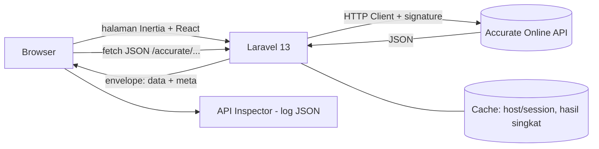

# Rancangan Sistem: `accurate-explorer` (Laravel 13)

**Aplikasi web eksplorasi API Accurate (PO dan Internal Transfer) berbasis Laravel 13 + React, lengkap dengan API Inspector**

> Status: rancangan awal, **versi Laravel**. Nama endpoint, parameter, dan field Accurate di dokumen ini adalah **asumsi berdasarkan pola umum** dan harus diverifikasi ke dokumentasi resmi (accurate.id/api-docs) serta uji Postman.
> 
> Perubahan dari versi sebelumnya: backend proxy yang tadinya route handler Next.js kini menjadi **Laravel 13**. Frontend tetap React, dibawa lewat **React starter kit Laravel (Inertia)**, sehingga seluruh aplikasi tetap satu proyek.

---

## 1. Tujuan dan Scope

**Tujuan:** menampilkan data Purchase Order dan Internal Transfer dari Accurate dalam bentuk aplikasi web, sekaligus memperlihatkan **bentuk respons JSON mentah** dari setiap interaksi pengambilan data, sehingga mudah dipakai untuk mempelajari API.

**Dalam scope**

- Daftar dan detail Purchase Order (PO).
- Daftar dan detail Internal Transfer / Pemindahan Barang (IT).
- **API Inspector**: log dan penampil JSON dari setiap panggilan GET.
- Pemilihan database Accurate, filter, paginasi, pencarian sederhana.

**Di luar scope (saat ini)**

- Menulis/mengubah data di Accurate (`save`, `delete`). Aplikasi **hanya-baca**.
- Menyimpan salinan data Accurate di database sendiri, OAuth multi-pengguna, modul lain.

---

## 2. Keputusan Arsitektur

### 2.1 Stack

| Lapisan | Pilihan |
| --- | --- |
| Backend | **Laravel 13** (PHP 8.3 atau lebih baru, Composer) |
| Frontend | **React + TypeScript** lewat React starter kit Laravel (Inertia) |
| Styling | Tailwind CSS (bawaan starter kit) |
| Build frontend | Vite (bawaan Laravel) |
| Data klien | TanStack Query, TanStack Table |
| Panggilan ke Accurate | HTTP Client bawaan Laravel (`Http::`) |
| Cache | Cache bawaan Laravel |

### 2.2 Tanpa database untuk data Accurate

Data PO dan IT **tidak disimpan**: diambil langsung dari Accurate setiap dibutuhkan, dengan cache singkat. Catatan: starter kit Laravel membutuhkan database kecil (SQLite bawaan sudah cukup) hanya untuk **akun login aplikasi dan sesi**, bukan untuk data perusahaan.

### 2.3 Kenapa tidak terkena CORS

Browser hanya berbicara dengan Laravel di origin yang sama. Laravel yang memanggil Accurate (server ke server), sehingga CORS tidak menjadi masalah.

### 2.4 Diagram arsitektur



### 2.5 Prinsip

1. **Kredensial hanya di backend** (`.env`), tidak pernah dikirim ke browser.
2. **Hanya-baca**: hanya modul dan aksi di *whitelist* (`config/accurate.php`) yang diteruskan.
3. **Backend membungkus respons** dalam *envelope* (data + metadata) agar Inspector bisa menampilkan detail panggilan tanpa membocorkan rahasia.
4. **Pisahkan lapisan Accurate dari controller dan tampilan** (kelas Service tersendiri).

---

## 3. Fitur Aplikasi

| No | Fitur | Deskripsi |
| --- | --- | --- |
| F1 | Login aplikasi | Autentikasi bawaan starter kit; pendaftaran publik dinonaktifkan, akun dibuat lewat seeder/artisan |
| F2 | Pilih database | Menampilkan hasil `db-list` dan membuka database yang dipilih |
| F3 | Daftar PO | Tabel PO dengan filter tanggal/status/pemasok, paginasi, pencarian |
| F4 | Detail PO | Header PO, baris barang, status, total |
| F5 | Daftar IT | Tabel IT dengan filter tanggal dan gudang |
| F6 | Detail IT | Gudang asal/tujuan, baris barang, status (misalnya Transit/Diterima) |
| F7 | **API Inspector** | Log semua panggilan GET beserta respons JSON-nya (bagian 4) |
| F8 | Ekspor | Unduh data tabel (CSV) dan respons JSON |

---

## 4. Fitur Utama: API Inspector

### 4.1 Tujuan

Setiap kali aplikasi mengambil data dari Accurate, pengguna bisa **melihat apa yang sebenarnya terjadi**: endpoint yang dipanggil, parameter, status, waktu respons, dan isi JSON mentah.

### 4.2 Tampilan

Panel yang bisa dibuka/ditutup (drawer) di semua halaman, dengan dua bagian:

**A. Daftar Log Panggilan** (terbaru di atas)

| Kolom | Isi |
| --- | --- |
| Waktu | Jam panggilan |
| Metode | GET |
| Endpoint | Misalnya `/purchase-order/list.do` |
| Status | HTTP status + status sukses/gagal dari body Accurate |
| Durasi | Dalam milidetik |
| Ukuran | Ukuran respons |
| Sumber | `live` atau `cache` |

**B. Detail Panggilan** (saat satu baris dipilih)

- Tab **Request**: endpoint, parameter query (`fields`, `sp.page`, `sp.pageSize`, `filter.*`), header yang aman ditampilkan. Header sensitif ditampilkan sebagai `••••`.
- Tab **Response (Tree)**: JSON berbentuk pohon yang bisa dilipat/dibuka, dengan pencarian kunci/nilai.
- Tab **Response (Raw)**: JSON mentah, rapi (pretty print), dengan penyorotan sintaks.
- Tab **Ringkasan**: jumlah record, info paginasi, daftar kunci tingkat atas, dan tipe data tiap field.
- Aksi: **Salin JSON**, **Unduh .json**, **Salin sebagai cURL (tanpa rahasia)**, **Ulangi panggilan**.

### 4.3 Cara kerja

1. Halaman React memanggil endpoint JSON Laravel, misalnya `GET /accurate/purchase-order/list?page=1`, memakai `fetch` (via TanStack Query) dengan cookie sesi yang sama.
2. Laravel menambahkan autentikasi (timestamp dan signature), memanggil Accurate, lalu membungkus hasilnya:

```json
{
  "data": { "...": "respons asli dari Accurate, tidak diubah" },
  "meta": {
    "id": "call_01HZ...",
    "timestamp": "2026-10-06T08:15:30Z",
    "method": "GET",
    "endpoint": "/purchase-order/list.do",
    "query": { "fields": "id,number,transDate", "sp.page": 1, "sp.pageSize": 20 },
    "httpStatus": 200,
    "durationMs": 412,
    "sizeBytes": 18230,
    "source": "live"
  }
}
```

3. Frontend menampilkan `data` di halaman, dan menyimpan seluruh envelope ke **store Inspector** (state di memori browser, maksimal misalnya 50 panggilan terakhir).
4. Pasang `InspectorProvider` di tingkat paling luar aplikasi (pembungkus di `resources/js/app.tsx`), **bukan** di dalam tiap halaman, agar log tidak hilang saat berpindah halaman lewat navigasi Inertia. (Verifikasi struktur `app.tsx` pada versi starter kit yang Anda pakai.)

### 4.4 Aturan keamanan Inspector

- Laravel **tidak pernah** memasukkan token, signature, secret, atau session ke dalam `meta`.
- Header sensitif disamarkan (`Authorization`, `X-Session-ID`, header signature/timestamp).
- "Salin sebagai cURL" memakai placeholder (`<TOKEN>`, `<SIGNATURE>`).
- Log hanya di memori browser (hilang saat tab ditutup), tidak disimpan di server.
- Respons berisi data perusahaan, jadi ekspor JSON berarti memindahkan data keluar aplikasi.

---

## 5. Rancangan Teknis

### 5.1 Pembuatan proyek

```
composer global require laravel/installer
laravel new accurate-explorer      # pilih starter kit: React
cd accurate-explorer
npm install && npm run dev         # frontend (Vite)
php artisan serve                  # backend
```

Alternatif tanpa installer: `composer create-project laravel/laravel accurate-explorer`, lalu pasang starter kit React secara terpisah. Cek panduan resmi Laravel 13 untuk perintah terbaru.

### 5.2 Struktur folder (bagian yang ditambahkan)

```
accurate-explorer/
├── app/
│   ├── Http/
│   │   ├── Controllers/Accurate/ExplorerController.php   # databases, list, detail
│   │   └── Requests/AccurateListRequest.php               # validasi parameter
│   └── Services/Accurate/
│       ├── AccurateClient.php     # panggilan HTTP + signature
│       ├── AccurateSession.php    # open-db, simpan host/session di cache, perbarui jika kedaluwarsa
│       └── ResponseEnvelope.php   # bungkus respons + redaksi
├── config/accurate.php            # whitelist modul/aksi, TTL cache, timeout
├── routes/web.php                 # route halaman + route JSON /accurate/*
├── resources/js/
│   ├── app.tsx                    # tambahkan InspectorProvider di sini
│   ├── pages/
│   │   ├── purchase-orders/index.tsx
│   │   ├── purchase-orders/show.tsx
│   │   ├── item-transfers/index.tsx
│   │   └── item-transfers/show.tsx
│   ├── components/
│   │   ├── data/DataTable.tsx
│   │   ├── data/FilterBar.tsx
│   │   └── inspector/
│   │       ├── InspectorProvider.tsx
│   │       ├── InspectorDrawer.tsx
│   │       ├── CallList.tsx
│   │       ├── CallDetail.tsx     # tab Request/Tree/Raw/Ringkasan
│   │       └── JsonTree.tsx
│   ├── hooks/useAccurate.ts       # TanStack Query + kirim envelope ke Inspector
│   └── types/accurate.ts
└── .env                           # tidak masuk repositori
```

### 5.3 Route dan whitelist

```php
// routes/web.php (kerangka)
Route::middleware(['auth', 'throttle:accurate'])
    ->prefix('accurate')
    ->group(function () {
        Route::get('databases', [ExplorerController::class, 'databases']);
        Route::get('{module}/list', [ExplorerController::class, 'list'])
            ->whereIn('module', ['purchase-order', 'item-transfer']);
        Route::get('{module}/detail', [ExplorerController::class, 'detail'])
            ->whereIn('module', ['purchase-order', 'item-transfer']);
    });
```

```php
// config/accurate.php (kerangka)
return [
    'modules' => [
        'purchase-order' => ['list', 'detail'],
        'item-transfer'  => ['list', 'detail'],
    ],
    'cache_ttl' => 180,   // detik
    'timeout'   => 30,
];
```

| Endpoint aplikasi | Diteruskan ke Accurate | Keterangan |
| --- | --- | --- |
| `GET /accurate/databases` | `db-list.do` | Daftar database |
| `GET /accurate/purchase-order/list` | `purchase-order/list.do` | Daftar PO |
| `GET /accurate/purchase-order/detail?id=` | `purchase-order/detail.do` | Detail PO |
| `GET /accurate/item-transfer/list` | `item-transfer/list.do` | Daftar IT |
| `GET /accurate/item-transfer/detail?id=` | `item-transfer/detail.do` | Detail IT |

Aturan: hanya GET, hanya modul/aksi di whitelist, parameter divalidasi lewat Form Request, selain itu ditolak.

### 5.4 Kerangka klien Accurate

```php
// app/Services/Accurate/AccurateClient.php (kerangka, verifikasi format header ke dokumentasi)
use Illuminate\Support\Facades\Http;

$timestamp = now()->format('d/m/Y H:i:s');            // format timestamp: verifikasi
$signature = base64_encode(
    hash_hmac('sha256', $timestamp, config('services.accurate.secret'), true)
);

$response = Http::baseUrl($host)
    ->withToken(config('services.accurate.token'))
    ->withHeaders([
        'X-Api-Timestamp' => $timestamp,               // nama header: verifikasi
        'X-Api-Signature' => $signature,
        'X-Session-ID'    => $session,
    ])
    ->timeout(config('accurate.timeout'))
    ->get($path, $params);
```

### 5.5 Variabel lingkungan (`.env`)

```
ACCURATE_API_TOKEN=...
ACCURATE_SIGNATURE_SECRET=...
ACCURATE_DB_ID=...            # opsional, default database
APP_DEBUG=false               # wajib false di produksi
```

Petakan ke `config/services.php`, dan baca lewat `config()` (bukan `env()` langsung di luar file config).

### 5.6 Sesi Accurate

- Panggilan pertama memanggil `open-db` untuk mendapat **host** dan **session**, disimpan di **Cache Laravel** (persisten antar-request, tidak hilang seperti memori serverless).
- Jika respons menandakan sesi tidak valid/kedaluwarsa, buka ulang database satu kali lalu ulangi panggilan.

### 5.7 Cache dan pembatasan

- `Cache::remember()` dengan kunci endpoint + parameter, TTL pendek (misalnya 2 sampai 5 menit). Tombol **Ulangi** melewati cache. Inspector menandai `source: live` atau `cache`.
- `RateLimiter::for('accurate', ...)` di `AppServiceProvider` untuk membatasi frekuensi panggilan per pengguna.

### 5.8 Penanganan error

- Gagal jaringan, token salah, sesi habis, dan batas request dipetakan ke respons error yang ramah, tanpa membocorkan detail internal.
- Panggilan yang gagal **tetap masuk Inspector** (status dan body error), karena berguna untuk belajar API.
- Jangan mencatat header autentikasi ke log Laravel.

---

## 6. Rancangan Halaman

| Halaman | Isi utama |
| --- | --- |
| Login | Bawaan starter kit |
| Ringkasan | Pemilihan database, status koneksi, panggilan terakhir |
| Daftar PO | Filter (tanggal, status, pemasok), tabel, paginasi, ekspor |
| Detail PO | Header, tabel baris barang, tombol "Lihat JSON" yang membuka Inspector pada panggilan terkait |
| Daftar IT | Filter (tanggal, gudang), tabel, paginasi |
| Detail IT | Gudang asal dan tujuan, status, baris barang, tombol "Lihat JSON" |
| Inspector (drawer) | Tersedia di semua halaman |

Field yang kemungkinan ditampilkan (**verifikasi nama field di respons asli**):

- **PO:** nomor, tanggal, pemasok, status, total, baris barang (kode, nama, qty, harga, satuan).
- **IT:** nomor, tanggal, gudang asal, gudang tujuan, status, baris barang dan qty.

---

## 7. Keamanan dan Kepatuhan

1. Kredensial hanya di `.env` server; `.env` tidak masuk repositori; `APP_DEBUG=false` di produksi.
2. Wajib login, pendaftaran publik dinonaktifkan.
3. Hanya-baca: whitelist modul dan aksi, hanya metode GET.
4. Gunakan database Accurate uji dulu. Data produksi hanya dengan izin pembimbing.
5. Konfirmasi ke pembimbing soal tempat hosting yang diperbolehkan dan apakah data boleh keluar dari lingkungan perusahaan.
6. Rate limit di route Accurate, HTTPS di produksi.

---

## 8. Hosting dan Deploy

- Perlu server dengan **PHP 8.3+**, Composer, dan ekstensi umum Laravel. Laravel bukan serverless, jadi tidak cocok untuk shared hosting yang sangat terbatas.
- Langkah umum: `composer install --no-dev`, `npm ci && npm run build`, `php artisan migrate --force`, `php artisan config:cache`, arahkan *document root* ke folder `public/`.
- Cek driver cache dan sesi (database atau file) sesuai hosting yang dipakai.

---

## 9. Tahapan Pengerjaan

| Tahap | Pekerjaan | Hasil |
| --- | --- | --- |
| 1 | Uji panggilan di Postman: db-list, open-db, list/detail PO dan IT | Kerangka respons dan field terverifikasi |
| 2 | Buat proyek Laravel 13 + starter kit React, atur login, nonaktifkan pendaftaran | Kerangka aplikasi berjalan |
| 3 | `AccurateClient`, `AccurateSession`, config whitelist, route + controller | Backend bisa mengambil data |
| 4 | Halaman daftar dan detail PO | Halaman PO berfungsi |
| 5 | Halaman daftar dan detail IT | Halaman IT berfungsi |
| 6 | **API Inspector**: provider, daftar log, tab Request/Tree/Raw/Ringkasan | Fitur utama jadi |
| 7 | Cache, rate limit, penanganan error, ekspor, rapikan UI | Prototipe siap didemokan |
| 8 | Deploy dan uji dengan data uji | Aplikasi dapat diakses pembimbing |

---

## 10. Pengembangan Lanjutan (opsional)

- Database untuk snapshot dan dependency map PO → RI → Faktur → Payment (Laravel sudah siap dengan Eloquent dan migrasi).
- Modul lain (Penerimaan Barang, Faktur, Pembayaran, daftar akun perkiraan).
- Perbandingan dua respons berdampingan (diff) di Inspector.
- OAuth, jika dipakai banyak pengguna atau banyak database.

---

## 11. Hal yang Harus Diverifikasi

- [ ] Nama modul dan endpoint final (`purchase-order`, `item-transfer`) serta parameter `fields`, `sp.*`, `filter.*`.
- [ ] Format header autentikasi dan format timestamp/signature di akun Anda.
- [ ] Alur `open-db` (host dan session) dan masa berlaku sesi.
- [ ] Batas ukuran halaman dan batas request.
- [ ] Nama field status IT (Transit/Diterima) di respons.
- [ ] Versi PHP di server (kemungkinan minimal 8.3 untuk Laravel 13), versi Inertia (2 atau 3) di starter kit, dan perintah instalasi starter kit React terbaru di dokumentasi resmi Laravel 13.
- [ ] Kebijakan perusahaan soal hosting dan penyimpanan data.